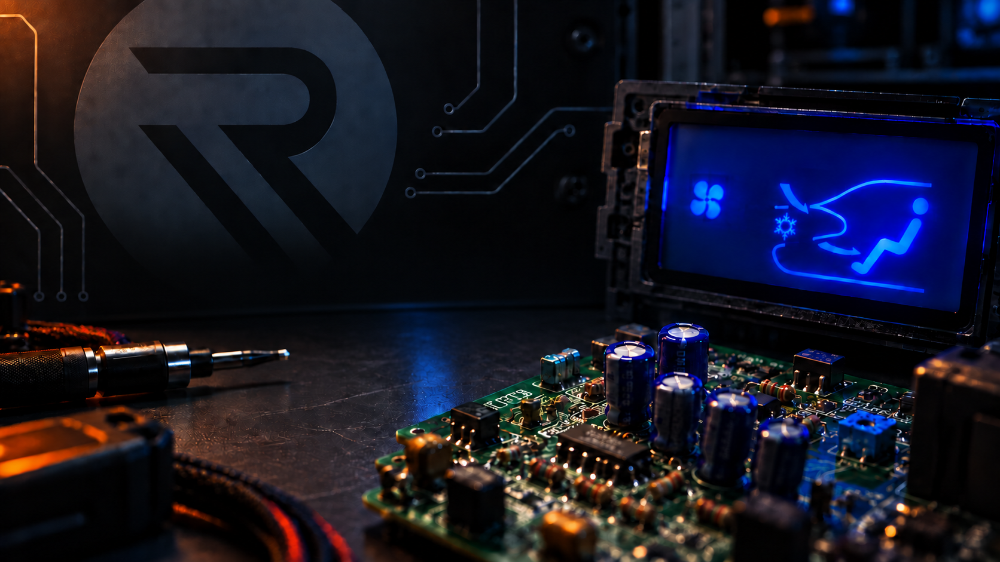

# Reforge

First-generation Reforge Basic and Advanced climate-control display conversions are **open for preorder** for compatible 1991–1997 Mitsubishi 3000GT and Dodge Stealth vehicles with digital climate control. Reforge is a mail-in conversion service, not a self-install kit. The factory climate-control computer and controls remain in place.

| Version | Best for | Preorder |
| --- | --- | --- |
| **Basic** | A fixed OEM-style display of live factory climate information. | [Preorder Basic](https://reforge.gonzoinc.com/product/reforge-1st-gen-climate-control-basic-preorder-deposit/) |
| **Advanced** | Custom templates, app uploads, touchscreen settings, screensavers, and plugin support. | [Preorder Advanced](https://reforge.gonzoinc.com/product/reforge-1st-gen-climate-control-advanced-preorder-deposit/) |

Each preorder requires a **$100 non-refundable deposit per unit**, credited toward the final conversion price. The current conversion prices are $500 for Basic and $575 for Advanced, before selected add-ons and return shipping. Preorders close **November 15, 2026 at 11:59 PM Eastern**. Read the product pages for compatibility, options, timing, and the full deposit terms. **Do not mail your unit with the deposit**; shipping instructions follow final payment.

The [Reforge website](https://reforge.gonzoinc.com/) is the source for current product and ordering information. This repository provides Windows app downloads, documentation, and app issue tracking. The available app installers and firmware packages have their own release status; a release labeled beta or alpha is still an early software build.

  

<h3 align="center">Connecting legacy to tomorrow.</h3>

  
  
  

  <a href="https://reforge.gonzoinc.com/"><strong>🌐 Visit the Reforge website</strong></a>
  &nbsp; • &nbsp;
  <a href="https://www.facebook.com/reforge3s/"><strong>📣 Follow Reforge on Facebook</strong></a>
  &nbsp; • &nbsp;
  <a href="https://github.com/gonzoinc/reforge/issues"><strong>🐛 Report an app bug</strong></a>

## Windows App and Firmware Downloads

Browse the [official Releases page](https://github.com/gonzoinc/reforge/releases) for the Windows installer, firmware packages, checksums, and release notes. Check each release's version, requirements, and limitations before installing. Verify downloaded files against their published SHA-256 checksums.

The installer is unsigned. Follow the [SmartScreen instructions below](#installing-unsigned-reforge-builds-on-windows) if Windows blocks a verified download. The app can update **Advanced** firmware over USB; Basic needs a separate compatible flashing workflow.

> [!IMPORTANT]
> Preordering a first-generation conversion does not change the status of individual app or firmware releases. Check the notes for the specific download you use. Software build checks alone do not establish hardware acceptance.

Reforge is a Windows desktop application for creating, managing, and uploading display templates for supported Mitsubishi 3000GT and Dodge Stealth digital climate-control display replacements.

- 🎨 Create and customize display templates.
- 🧩 Manage artwork, layouts, and display assets.
- 🚀 Upload finished templates to supported Reforge displays over USB or Bluetooth.

## 🔧 Basic and Advanced Display Versions

Two Reforge display versions are available to preorder as first-generation mail-in conversions. Both replace the original display and show live factory climate-control information, but they offer different levels of customization. The current preorder is for a conversion service, not a retail display or a self-install kit.

> [!IMPORTANT]
> A 1st-gen DCC does not automatically include the Advanced features. Custom templates, multiple template slots, app/USB/Bluetooth template uploads, touchscreen settings, user-adjustable and automatic dimming, screensavers, and plugins require the **1st-gen DCC Advanced Version**. The 1st-gen DCC Basic Version does not support those features.

| Feature | 1st-gen Basic Version | 1st-gen Advanced Version |
| --- | :---: | :---: |
| Designed for the 1st-gen DCC | ✅ | ✅ |
| Live temperature, fan, vent mode, A/C, AUTO, ECON, and intake status | ✅ | ✅ |
| 3.5-inch 480 × 320 color display | ✅ | ✅ |
| Built-in Reforge `1st Gen OEM DCC` display layout | ✅ | ✅ |
| Dims with the vehicle illumination signal | ✅ | ✅ |
| User-adjustable brightness and automatic dimming | ❌ | ✅ |
| Custom display templates | ❌ | ✅ |
| Multiple template slots | ❌ | ✅ |
| Template upload from the Reforge app | ❌ | ✅ |
| USB template upload | ❌ | ✅ |
| Bluetooth template upload | ❌ | ✅ |
| Touchscreen menu and settings | ❌ | ✅ |
| Screensaver support | ❌ | ✅ |
| Reforge plugin support | ❌ | ✅ |
| Passive CAN and digital-input plugins | ❌ | ✅ |

### Basic

Basic is the simple OEM-style version. It starts directly into the built-in `1st Gen OEM DCC` layout and displays the normal climate-control information. It has no custom templates, template uploads, Bluetooth service, touchscreen menu, screensaver, user settings, or plugins. Display brightness switches between fixed normal and dim levels using the vehicle illumination signal.

### Advanced

The **1st-gen DCC Advanced Version** is the customizable 1st-gen product. It supports Reforge templates, two on-device template slots, app/USB/Bluetooth template uploads, touchscreen controls, persistent brightness and automatic dim/black settings, screensavers, and Plugin API v1. The 1st-gen DCC Basic Version does not support those features. Plugin API v1 also does not support 2nd-gen DCC boards.

See [Building Reforge Plugins](plugin.md) for the package format, available inputs, manifest examples, and current development status.

Complete examples are available in the [reference plugins folder](plugins/README.md), including the configurable [Reforge CAN Mapper](plugins/can-mapper/README.md).

> [!NOTE]
> Advanced plugin support remains limited to the **1st-gen DCC Advanced Version**. Firmware export and live on-device plugin data are not complete yet.

> [!TIP]
> 📣 **Follow [Reforge on Facebook](https://www.facebook.com/reforge3s/) for project updates and release news.** Visit [reforge.gonzoinc.com](https://reforge.gonzoinc.com/) for current preorder information.

> [!WARNING]
> App and firmware prereleases may contain bugs or incomplete features. Review the notes for the version you download.

## About This Repository

This repository is the public home for:

- Official compiled Reforge app and firmware downloads.
- End-user information and release notes.
- App bug reports and issue tracking.
- License, notices, and branding terms.

Application source code, firmware source code, hardware designs, PCB files, manufacturing files, and private development material are **not published in this repository**.

## 🖥️ System Requirements

- Windows 10 or Windows 11, 64-bit.
- The installer includes the required .NET desktop runtime; a separate .NET installation is not required.

## 📦 Downloading Reforge

1. Open [Releases](https://github.com/gonzoinc/reforge/releases).
2. Choose the Windows app release appropriate for your display and review its notes. Basic and Advanced firmware have separate release pages.
3. Download the Windows installer attached to the selected release.
4. Compare the installer’s SHA-256 hash with the published checksum before running it.

## 🛡️ Installing Unsigned Reforge Builds on Windows

Reforge installers are not code-signed. On some Windows systems, Microsoft Defender SmartScreen blocks the installer completely and does not offer a **Run anyway** option. In that case, SmartScreen's app check must be disabled temporarily before the installer can run.

Before changing SmartScreen:

1. Confirm that the installer came from this repository's [official Releases page](https://github.com/gonzoinc/reforge/releases).
2. Compare the downloaded installer's SHA-256 hash with the checksum published beside that release.
3. Do not continue if the filename or checksum does not match.

To install when SmartScreen blocks the file:

1. Open **Windows Security** from the Windows Start menu.
2. Select **App & browser control**.
3. Select **Reputation-based protection settings**.
4. Turn **Check apps and files** off. Approve the Windows confirmation prompt if one appears.
5. Run the Reforge installer again.
6. Windows will still display a confirmation warning because the installer has an unknown publisher. Select the affirmative option—such as **Yes**, **Run**, or **Proceed**—to continue the installation.
7. As soon as installation finishes, return to **Windows Security → App & browser control → Reputation-based protection settings** and turn **Check apps and files** back on.

> [!IMPORTANT]
> Disable only **Check apps and files**, only for the time needed to install the verified Reforge download, and re-enable it immediately afterward. Do not disable antivirus protection or other Windows Security features. If a work or school administrator controls this setting, contact that administrator instead of bypassing the policy.

See Microsoft's [App & browser control documentation](https://support.microsoft.com/en-us/windows/app-browser-control-in-the-windows-security-app-8f68fb65-ebb4-3cfb-4bd7-2a32ea6bd946) for additional information about SmartScreen and reputation-based protection.

## 🐛 Reporting an App Bug

Use the [Reforge app bug form](https://github.com/gonzoinc/reforge/issues/new?template=bug-report.yml). The form asks for the app version, affected area, Windows version, steps to reproduce the problem, and any useful screenshots or logs.

Before filing a report:

- Check [existing issues](https://github.com/gonzoinc/reforge/issues) for the same problem.
- Remove passwords, access tokens, private keys, personal information, and other secrets from screenshots or logs.
- Report only Reforge desktop-app problems here. Firmware, hardware, wiring, installation, and vehicle issues are outside this repository’s current bug-tracking scope.

The app’s yellow bug button opens the repository’s Issues page in the default web browser.

## ⚖️ License

Official Reforge app binaries are licensed for personal, educational, repair, hobby, research, and other noncommercial use under the [PolyForm Noncommercial License 1.0.0](LICENSE.md), subject to the required notices in that file.

Commercial use is not included. See [Commercial Licensing](COMMERCIAL-LICENSE.md) for examples and additional information.

The license does not grant access to or rights in unpublished source code, firmware source, hardware designs, PCB files, manufacturing data, trademarks, logos, or branding.

## 📚 Legal And Project Documents

- [Plugin Authoring Guide](plugin.md)
- [Software License](LICENSE.md)
- [Notices](NOTICE.md)
- [Commercial Licensing](COMMERCIAL-LICENSE.md)
- [Bug Reports and Contributions](CONTRIBUTING.md)
- [Security Policy](SECURITY.md)
- [Trademarks and Branding](TRADEMARKS.md)

## ℹ️ Independence Notice

Reforge is an independent project and is not affiliated with, sponsored by, or endorsed by Mitsubishi, Dodge, Stellantis, or any related trademark holder. Third-party names are used only to identify compatibility and source-hardware context.
